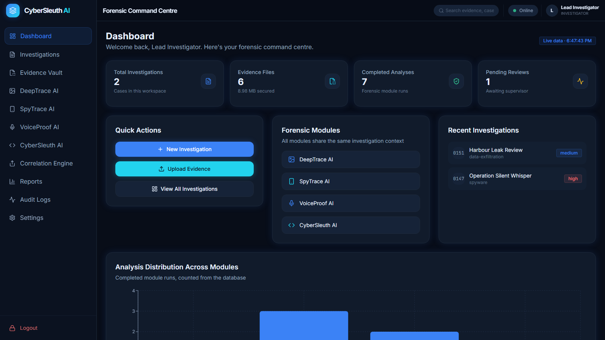
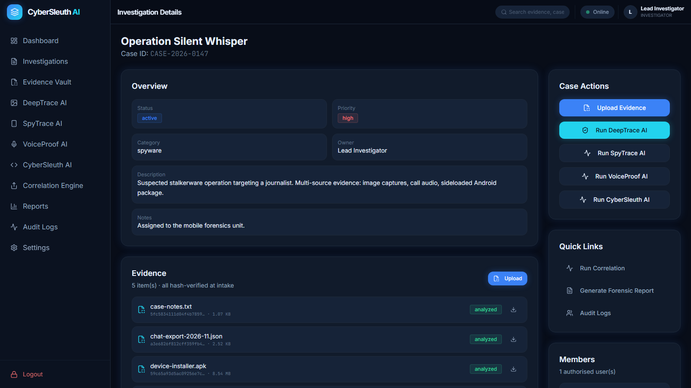
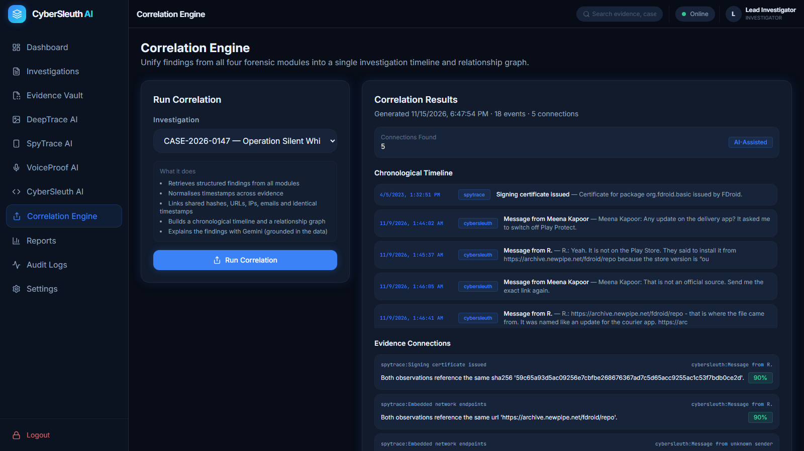

# 🔍 CyberSleuth AI

> **Multimodal AI-Powered Digital Forensics & Evidence Reconstruction Platform**
>
> *Detect the Threat. Decode the Evidence. Reconstruct the Truth.*

CyberSleuth AI is a unified digital forensics platform for investigators to **upload, securely store, analyse, correlate, and report** digital evidence from multiple sources — images, video, audio, Android packages, and structured artefacts.

Four specialist forensic modules work inside **one shared investigation system**, connected by a correlation engine that links genuine shared indicators (hashes, URLs, IPs, emails and identical timestamps) across artefacts.

| Module | Purpose | Engine |
| --- | --- | --- |
| **DeepTrace AI** | Image forensics | OpenCV + Pillow — EXIF, Error Level Analysis, noise residuals, copy-move detection, 8×8 grid analysis |
| **SpyTrace AI** | Android package forensics | Androguard — manifest, permissions, signing certificate, exported components, embedded network endpoints |
| **VoiceProof AI** | Audio forensics | Librosa — segment/silence structure, splice-seam heuristics, level statistics |
| **CyberSleuth AI** | Artefact extraction | spaCy NER + regex — timestamps, entities, emails, URLs, IPs, hashes, chat-export structure |

---

## Why it looks like a real platform

Everything this repository ships is wired to **real systems, not placeholders** — and the repository seeds a complete, worked case so the app demonstrates itself honestly:

- **Real database.** Migrations build a proper PostgreSQL schema (11 tables, RLS on every table, restricted application role). Local development uses a portable embedded PostgreSQL; no account is required.
- **Real forensic pipeline.** The seeded case (Operation Silent Whisper) was analysed by the actual modules: EXIF findings from a real JPEG, segment analysis of a synthesised WAV, a full static analysis of a real F-Droid APK, and entity extraction from a real chat export.
- **Real integrity chain.** SHA-256 fingerprints at intake, re-hash verification of stored originals, and an append-only, hash-chained chain of custody — the report embeds the real manifest.
- **Real AI explanation.** Correlation findings are explained by Google Gemini, grounded strictly in the structured findings (never inventing relationships).
- **Real browser-verified UI.** Login → dashboard → investigation → analysis → correlation → report — all verified end-to-end in Chromium with zero console errors.





---

## Quick start (local, zero-config)

**Prerequisites:** Node.js 18+, Python 3.10+ (3.10/3.11 recommended), Git.

### 1. Backend

```bash
cd backend
python -m venv .venv
.venv\Scripts\Activate.ps1          # Windows
# source .venv/bin/activate         # macOS / Linux
pip install -r requirements.txt
python -m spacy download en_core_web_sm
```

### 2. Frontend

```bash
cd frontend
npm install
npm run dev                         # http://localhost:3000
```

### 3. Run the API (separate terminal)

```bash
cd backend
..\.venv\Scripts\python.exe -m uvicorn app.main:app --host 127.0.0.1 --port 8000
```

On first start the API creates an embedded PostgreSQL under `backend/.pgdata`, applies all migrations, provisions the restricted `cybersleuth_app` role and serves on **http://127.0.0.1:8000** (docs at `/docs`).

### 4. Sign in with the seeded accounts

| Role | Email | Password |
| --- | --- | --- |
| Investigator | `investigator@cybersleuth.ai` | `Investigator!2026` |
| Supervisor | `supervisor@cybersleuth.ai` | `Supervisor!2026` |

> These are **seeded local-demo accounts** created by the seed script below. They exist so you can explore the full workflow immediately. Rotate or remove them in any real deployment.

### 5. (Re)seed the realistic case

```bash
python scripts/seed_demo_data.py
```

Idempotent. It creates the two demo accounts, the **Operation Silent Whisper** case (CASE-2026-0147) with five real evidence items (a screen photo with EXIF, a call recording, a genuine F-Droid APK, a chat export and investigator notes), runs every forensic module on them, executes the correlation pass, and renders the PDF report.

> **Note on the seeded evidence:** the image, audio and chat artefacts were synthesised so the repository contains no real personal data; the APK is the publicly distributed, open-source F-Droid Basic package used purely as a sample. The hashes, analyses, custody events, correlations and the PDF are all produced by the platform itself.

---

## VS Code Dev container (Ubuntu 22.04)

The whole stack can run inside a **Linux (Ubuntu) container** opened in VS Code — no local Python/Node setup, and the forensic system libraries are already installed.

| File | Purpose |
| --- | --- |
| `.devcontainer/devcontainer.json` | Container definition, forwarded ports (3000 / 8000), extensions, Python interpreter |
| `.devcontainer/Dockerfile` | Ubuntu 22.04 + Python 3.10 + Node 20 + `libsndfile1` / `libglib2.0-0` / `ffmpeg` for the forensic stack |
| `.devcontainer/post-create.sh` | One-time bootstrap (pip deps, spaCy model, `npm ci`) |
| `.devcontainer/post-start.sh` | Banner with the forwarded URLs |

**Open it:** VS Code → `Ctrl+Shift+P` → **Dev Containers: Reopen in Container** (or *Open in Container*). The first build takes a few minutes; afterwards the layer cache makes rebuilds instant.

Inside the container:

```bash
# Task "CyberSleuth: start full stack" does both at once (API + UI)
python3.10 -m uvicorn app.main:app --host 127.0.0.1 --port 8000 --reload   # in backend/
npm run dev                                                               # in frontend/
```

- Frontend → <http://localhost:3000> (the Vite proxy forwards `/api` to the API inside the container)
- API docs → <http://localhost:8000/docs>

The embedded PostgreSQL (`pgserver`) is provisioned automatically on first API start under `backend/.pgdata`, so the container is self-contained — no database server required.

**One-click tasks** (`Ctrl+Shift+P` → *Tasks: Run Task*):

| Task | Does |
| --- | --- |
| `CyberSleuth: start full stack` | API on 8000 + Vite on 3000, in parallel |
| `CyberSleuth: start API` / `CyberSleuth: start frontend` | One side only |
| `CyberSleuth: run backend tests` | `pytest -q` against the isolated test database |
| `CyberSleuth: typecheck frontend` | `tsc --noEmit` |
| `CyberSleuth: seed demo data` | Re-creates the seeded case (idempotent) |
| `CyberSleuth: debug API` | Debug configuration for the FastAPI app (F5) |

> The devcontainer is optional — the native Windows/macOS/Linux quick start below works exactly the same.

---

## Testing

```bash
cd backend
..\.venv\Scripts\python.exe -m pytest -q
```

**41 tests** against a dedicated `cybersleuth_test` database: auth (register/login/refresh/429 rate limiting), RBAC and RLS-backed access control, duplicate-case 409 handling, evidence upload + SHA-256 verification + chain-of-custody validation, DeepTrace/CyberSleuth endpoints, correlation engine unit tests, PDF report generation and download.

Frontend verification: TypeScript strict `tsc --noEmit` + production build + a Chromium end-to-end smoke run (login, dashboard data, deeptrace run, reports, audit logs) with **zero console errors**.

---

## Deployment

| Piece | Target | How |
| --- | --- | --- |
| Frontend (SPA) | **GitHub Pages** (public demo) | `node scripts/deploy_github_pages.mjs --api-base-url <url>` builds the app with the `/<repo>/` base path and publishes it to the `gh-pages` branch. No access wall, no Netlify login. |
| Frontend (SPA) | **Netlify** | Connect the repo; `netlify.toml` already configures base `frontend`, `npm run build`, publish `dist`, SPA fallback and security headers. Set `VITE_API_BASE_URL=https://<backend>/api` in the Netlify env. |
| Backend (API) | **Render** (or Railway) | `render.yaml` blueprint included. Build context is the repo root: `docker build -t cybersleuth-api -f backend/Dockerfile .` |
| Database / Auth / Storage / RLS | **Supabase** (or any Postgres) | Apply `supabase/migrations/*.sql` in order (e.g. `supabase db push`). The same files run locally against the embedded server — one schema, both environments. Create the three private buckets (`evidence-originals`, `evidence-derived`, `reports`) — migration 009 does this on Supabase. |

### Public demo (no login required)

The Netlify site of this repository belongs to the team *Desi Boyzzz*, whose
plan forces **"Members only"** visibility on every site it owns. That is a
team-level setting: it cannot be switched off per site and it cannot be
changed through the API, so `cybersleuth-ai.netlify.app` answers `401` for
every visitor. The older `inquisitive-tapioca-615ed3.netlify.app` still
serves the previous build, but it is not in any account that can be reached
from this machine.

Two public paths replace it:

1. **GitHub Pages** — the published demo lives at
   `https://u20040519-glitch.github.io/cybersleuth-ai/`. It is served by the
   repository itself, so it stays up when this machine is off.

   ```bash
   # publish the frontend (build + push to the gh-pages branch)
   node scripts/deploy_github_pages.mjs --api-base-url https://<api>/api

   # move the published demo to another API without rebuilding
   node scripts/set_pages_api_url.mjs --url https://<api>
   ```

2. **The local stack behind a tunnel** — the API, the preview server and
   Cloudflare quick tunnels run on this machine, so the whole application is
   reachable from anywhere under a single HTTPS address:

   ```powershell
   powershell -ExecutionPolicy Bypass -File scripts/start_public_demo.ps1 -Publish
   powershell -ExecutionPolicy Bypass -File scripts/stop_public_demo.ps1
   ```

   The supervisor keeps both tunnels alive, and republishes the new address
   to the Pages build whenever a tunnel is replaced, so the demo follows
   along. The address is written to `scripts/.public-demo.txt`.

   `scripts/start_public_demo.ps1` is the fastest way to see the finished
   product: the API runs against the embedded PostgreSQL, the seeded case
   (`CASE-2026-0147`) is already in the database, and the demo credentials
   are `investigator@cybersleuth.ai` / `Investigator!2026`.

   `cloudflared` is used when it is installed (`%USERPROFILE%\bin\cloudflared.exe`);
   without it the supervisor falls back to an SSH tunnel. The difference
   matters for the Pages build: a Cloudflare tunnel forwards CORS preflight
   requests to the origin, so the build may call the API from another
   origin, while the SSH edge answers preflight requests itself.

### Packing the project for another machine

```bash
python scripts/package_local_release.py
```

writes `cybersleuth-ai-local.zip`: every tracked source file plus the built
frontend. The `.env` files are gitignored and therefore never part of the
archive — copy `backend/.env.example` and `frontend/.env.example` instead.

### Environment variables

Backend (`backend/.env`, never committed):

| Variable | Purpose |
| --- | --- |
| `APP_SECRET_KEY` | Session signing (≥32 chars) |
| `DATABASE_URL` | Privileged URL for migrations **only** (e.g. Supabase Postgres). Leave unset locally to use the embedded server. |
| `APP_DATABASE_URL` | Restricted runtime connection (role `cybersleuth_app`). Leave unset locally to auto-provision. |
| `APP_DB_USER` / `APP_DB_PASSWORD` | Restricted role name/password used by migrations to provision |
| `GEMINI_API_KEY` / `GEMINI_MODEL` | AI explanation layer (backend only; default model `gemini-3.5-flash`) |
| `SUPABASE_URL` / `SUPABASE_ANON_KEY` / `SUPABASE_SERVICE_ROLE_KEY` | Supabase project (optional locally) |
| `STORAGE_BACKEND` | `local` (default) or `supabase` |
| `CORS_ORIGINS` | Comma-separated allowed origins |

Frontend: **only** `VITE_*` variables are public. `GEMINI_API_KEY` and any service-role key must never be given a `VITE_` prefix.

---

## Security model

- **Argon2id** password hashing; short-lived JWT access tokens + refresh tokens (refresh re-reads the profile under RLS).
- **Row Level Security** on every table, enforced by PostgreSQL itself — the API connects as the non-superuser `cybersleuth_app` role, so even a bug in application code cannot read another case's rows. Local and Supabase environments run identical policies.
- **Immutable originals** — the database refuses changes to `sha256_hash`, `storage_path`, `original_filename` and `file_size`; the originals bucket has no UPDATE policy.
- **Append-only, hash-chained custody ledger** — `chain_of_custody` rejects UPDATE/DELETE; each event hashes the previous one.
- **Append-only audit log** — INSERT-only policy, no UPDATE/DELETE, verified by tests.
- **Rate limiting** on auth endpoints (per-IP, in-memory; swap for Redis in multi-replica deployments) and **security headers** on every response.
- **Integrity** — SHA-256 re-verified after every stored upload; `/evidence/{id}/integrity-check` re-checks on demand; the custody chain is verifiable via `/evidence/{id}/custody/verify`.

See [`docs/SECURITY.md`](docs/SECURITY.md) for the full threat model and deployment checklist.

---

## Known limitations (honest)

1. **No calibrated forensic models** ship in the box. DeepTrace/SpyTrace/VoiceProof produce measured heuristics and label every finding as `measured`/`heuristic`/`model`; `confidence_score` is only reported when a model produces it (none currently). Nothing is presented as a verdict.
2. **The Gemini explanation layer** requires `GEMINI_API_KEY`; without it the correlation runs but reports `available: false` with a reason instead of fabricating prose.
3. **The seeded demo accounts must be removed or rotated** in any real deployment; the default `APP_DB_PASSWORD` is a development value.
4. **Rate limiting** is in-memory per process — use Redis for multi-replica deployments.
5. **SPA-only browser hardening** is set by the API/Netlify headers; the frontend itself ships no third-party scripts.
6. The **embedded PostgreSQL** is for single-machine development; production should use managed Postgres (Supabase recommended) — the same migrations apply.

---

## Project structure

```
├── frontend/               # React 18 + TypeScript + Vite + Tailwind
│   ├── src/pages/          # 16 pages (dashboard, modules, correlation, reports…)
│   ├── src/components/     # Layout, UI kit, shared ModuleAnalysisPage
│   ├── src/services/api.ts # Typed API client (JWT + refresh-on-401)
│   └── src/context/        # AuthContext backed by the live backend
├── backend/                # FastAPI + SQLAlchemy 2 + asyncpg
│   ├── app/api/            # auth, investigations, evidence, analysis (×4), correlation, reports, audit, dashboard
│   ├── app/forensic/       # deeptrace, spytrace, voiceproof, cybersleuth analyzers (base contract in base.py)
│   ├── app/correlation/    # deterministic entity/timestamp correlation engine + Gemini explanation
│   ├── app/reports/        # reportlab PDF renderer
│   ├── app/database/       # local embedded PG bootstrap, migration runner, RLS provisioner
│   └── tests/              # 41 pytest tests (auth, RBAC, evidence, forensics, reports, health)
├── supabase/migrations/    # 12 SQL migrations — source of truth for the schema (local + Supabase)
├── scripts/seed_demo_data.py
├── docs/                   # ARCHITECTURE, API, SECURITY, screenshots
└── netlify.toml / render.yaml / backend/Dockerfile
```

## Documentation

| Document | Contents |
| --- | --- |
| [`DEVELOPMENT_STATUS.md`](DEVELOPMENT_STATUS.md) | Phase-by-phase status with verification evidence |
| [`docs/ARCHITECTURE.md`](docs/ARCHITECTURE.md) | System, database and module design |
| [`docs/API.md`](docs/API.md) | Endpoint reference |
| [`docs/SECURITY.md`](docs/SECURITY.md) | Threat model and hardening checklist |

## License

MIT — see [`LICENSE`](LICENSE).
